# HemoScan

**Check your hemoglobin. No needles.**

HemoScan estimates hemoglobin from photos of the **inner eyelid**, **fingernails** and **palm**, and
screens for anemia using WHO thresholds. It is built for rural India, health camps and home use,
and supports English, Telugu and Hindi.

- Everything runs on the device, including image processing and ML inference. It works offline as a PWA and as an Android APK.
- One React + TypeScript codebase serves the **web app** (laptop/projector demos) and the **Android app** (Capacitor).
- It is a **screening tool, not a diagnostic device.** Positive results must be confirmed with a blood test.

> **Models:** HemoScan ships **trained models** (v `2026.09-india-v3`) built from public research
> datasets — see [Trained models: data and accuracy](#trained-models-data-and-accuracy). Demo-mode
> sample images use a clearly labelled simulated model because they are drawings.

## How HemoScan adapts to the person

| Factor | How it is used | Why |
| --- | --- | --- |
| **Age, sex, pregnancy** | Selects the WHO cutoff group (`src/config/severityThresholds.json`) | WHO 2011 cutoffs, also used by India's Anemia Mukt Bharat / NFHS (e.g. 12.0 g/dL is normal for non-pregnant women, 13.0 for men) |
| **Location** (country, state, city, altitude) | WHO altitude adjustment subtracted before classification (0 below 1000 m … −2.7 g/dL at 3500 m); Ladakh pre-fills 3500 m, hill states prompt for altitude | People living high up have naturally higher hemoglobin |
| **Skin tone** (photo of forearm/back of hand → ITA°, or self-picked swatch, or measured from finger skin during the nail scan) | Lowers the palm's weight on darker skin | Palm pallor is harder to see on darker skin; eye and nails are more reliable |
| **Diet** (asked directly) | Pre-fills the questionnaire and guidance (B12, iron sources) | |
| **Pre-scan checklist** — crying/rubbed eyes, eye irritation, nail polish/mehndi, finger injury, nails cut very short, cold hands, mehndi on palm, hot water/exercise | Lowers or removes that region's weight (`pipeline.json → confounders`) and explains it on Results | These make tissue look redder or paler than the blood really is |
| **Automatic image checks** — red sclera, polish/henna colours, dark spot (bruise) on a nail | Same as above | Catches what people forget to report |

HemoScan never infers ethnicity, culture or diet from a person's face or skin; skin tone is used
only for the optical reliability of the palm.

---

## Trained models: data and accuracy

| Region | Training data | People | Accuracy on held-out people (5-fold, grouped by person) |
| --- | --- | --- | --- |
| Eye (inner eyelid) | CP-AnemiC — 710 Ghanaian children (Mendeley [doi:10.17632/m53vz6b7fx.1](https://doi.org/10.17632/m53vz6b7fx.1), CC BY 4.0) **+ Eyes-defy-anemia — 94 Indian and 120 Italian adults** ([Kaggle](https://www.kaggle.com/datasets/harshwardhanfartale/eyes-defy-anemia) / [IEEE DataPort](https://ieee-dataport.org/documents/eyes-defy-anemia)); lab Hb. Indian samples weighted ×3; age and sex are model inputs | 924 | **Indian adults: MAE 1.29 g/dL** (baseline 1.69), anemia accuracy 79.8 %; all eyes MAE 1.34, r = 0.71, accuracy 84.1 %. Catches ~95 % of anemic Indians but specificity is ~41 % (many false alarms near the cutoff) |
| Fingernails | Skin & fingernail photos of adults aged 18–95 in Moscow; venous Hb. figshare [doi:10.6084/m9.figshare.c.6760179](https://doi.org/10.6084/m9.figshare.c.6760179), CC0 | 196 (54 excluded as blurry / over-exposed) | MAE **1.78 g/dL** (baseline 1.86), r = 0.37, accuracy 73.3 % — weak |
| Palm | Anemic / non-anemic palm photos of children aged 6–59 months, Ghana (Asare et al., Mendeley Data [doi:10.17632/ccr8cm22vz.1](https://doi.org/10.17632/ccr8cm22vz.1), CC BY 4.0). No Hb values exist, so this is an **anemia check (probability)**, not an Hb estimate | 475 original photos (augmented copies kept together) | AUC **0.85**; finds 79 % of anemic cases, 78 % correct on non-anemic. Shown next to the Hb result (never changes the number); flags disagreement. 74 % of these photos are softer than the app's blur check allows, so treat it as indicative |

- **Overall (model 2026.10-india-v4):** anemia yes/no **accuracy 82.2 %**, precision 80.2 %, recall 86.2 %,
  specificity 78.1 %, F1 0.83, AUC 0.88, R² 0.48, MAE 1.42 g/dL (previous model: 79.0 %, F1 0.80, MAE 1.47).
  The gain came from deeper XGBoost trees (depth 6, 600 trees, learning rate 0.03), chosen by repeating
  grouped cross-validation on three different person splits (average 80.4 % vs 77.8 %; this split: 82.2 %).
  `python training/model_metrics.py` writes the full scorecard, which the app shows in **Settings → Model performance**.
- **Models:** colour-feature XGBoost (quantile 10/50/90 %) with a Random Forest fallback. With so little data
  the CNN was left out. The 80 % ranges are **conformally calibrated** on the held-out predictions
  (eye ±≈2.3, nails ±≈2.7 g/dL around the estimate). Palm: `python train_palm_classifier.py && python export.py --skip-cnn --skip-trees --palm`.
- **Known limits:** the Indian eye photos were taken with a magnifying lens and a fixed LED light; ordinary
  phone photos look different, so real-world accuracy is likely worse than the numbers above. The nail data
  are from Moscow adults, and the palm data from Ghanaian children. None of it was captured with this app. Accuracy on real users is unknown until a local
  validation study (photos + same-day blood tests) is done — the training pipeline in `training/` is
  ready for that data.
- **Reproduce:** `cd training && python prepare_public_datasets.py && python train.py && python export.py --skip-cnn`
  (downloads: see `training/README.md`).

### Out-of-range photos and personal calibration

- **Out-of-range check:** every scan compares the photo's key colour features (redness, red/green ratio,
  saturation…) with the 1st–99th percentile of the training photos **for the person's age group**. If two or
  more fall outside, that region counts half as much, gets a 1.5× wider range, and the result says the photo
  looks different from the training photos. Example: an ordinary phone photo of a healthy Indian man's eyelid
  (lab 14.5 g/dL) was *less red than every Indian training photo* (those were taken with a macro lens + LED),
  so the model read 11.9. The app now flags this instead of stating "mild anemia" with confidence.
- **Personal calibration:** after a scan, enter a blood-test result (CBC / HemoCue) taken within 7 days. The
  app stores `lab − photo estimate` on the profile and corrects future scans by
  `mean offset × n/(n + 0.5)` (one test is not fully trusted), capped at ±4 g/dL, ignoring tests older than a
  year. The corrected result says so and shows the uncalibrated estimate. Settings live in
  `pipeline.json → personalCalibration`; the profile screen shows and clears the calibration.

### Learning from blood tests (grows with use)

- **Entering a blood test (optional):** on the result screen, or later from **History → the scan**, the user
  types the lab hemoglobin and the test date (must be within 7 days of the scan). It can be edited or removed.
  The scan keeps its colour measurements (numbers only, never the photo) and the person's age/sex/state at
  scan time, so the pair *photo measurements ↔ real hemoglobin* is complete.
- **Personal:** the pair also becomes a personal-calibration point for that person (above).
- **Device learning:** every pair on the phone (all profiles) fits `correction = a + c·(estimate − mean)`
  with shrinkage (`pipeline.json → deviceLearning`). It is switched **on only when it lowers the error in a
  leave-one-person-out check** (≥ 5 tests from ≥ 2 people), and is used for people who have no blood test of
  their own. Results show "Learned from blood tests on this phone". This fixes the main error source — the
  phone's camera and lighting — for everyone scanned on that phone (e.g. one health-camp phone).
- **Growing the main model:** Settings → *Learning from blood tests* → **Export learning data** gives an
  anonymous JSON file (colour features, lab Hb, age, sex, state, pregnancy; people numbered p1, p2…).
  Put export files in `training/data/app_exports/`, then
  `python merge_app_exports.py && python train.py --features artifacts/features_with_app.npz` and export a new
  model version. App users count as Indian data (weight ×3).
- It does **not** retrain the model on the phone itself: a few dozen pairs are enough for a reliable
  phone-level correction, not for re-learning colour → hemoglobin. That happens in training with exports from
  many phones.

---

## Quick start

Requirements: **Node 20+**, npm. For the APK you also need JDK 17 and the Android SDK (API 34).

```bash
npm install          # also copies OpenCV.js + MediaPipe WASM and downloads the landmark models (one time, needs internet)
npm run dev          # http://localhost:5173 (camera works on localhost)
npm test             # unit tests (Vitest)
npm run build        # type-check + production build + service worker → dist/
npm run preview      # serve dist/ at http://localhost:4173
```

| Script                                | What it does                                                                   |
| ------------------------------------- | ------------------------------------------------------------------------------ |
| `dev` / `build` / `preview`           | Vite dev server / production build / serve build                               |
| `test`, `lint`, `typecheck`, `format` | Vitest, ESLint, `tsc --noEmit`, Prettier                                       |
| `android:sync`                        | build + copy web assets into the Android project                               |
| `android:open`                        | open the Android project in Android Studio                                     |
| `android:build`                       | build + sync + `gradlew assembleDebug` → debug APK                             |
| `android:release`                     | build + sync + `gradlew assembleRelease` → signed release APK (see below)      |
| `demo:generate`                       | regenerate the synthetic demo images (`public/demo/`)                          |
| `demo:calibrate`                      | re-fit the simulated model so demo images land in their intended severity band |
| `parity:fixtures`                     | regenerate the app↔training parity fixtures (`training/tests/fixtures/`)       |

---

## Demo mode (for project reviews)

No camera needed:

1. Open the app and complete the first-launch steps: language, onboarding, consent, profile.
2. On **Home**, click **Try Demo**.
3. Pick a sample set (**Healthy / Mild / Moderate / Severe**). The **full pipeline** runs on its eye, nail
   and palm images: quality check → lighting correction → region finding → color analysis →
   estimate → fusion → WHO severity.
4. Explore **Why might this be happening?** (questionnaire → guidance), **What should I do?**,
   **Save**, **Download report** (PDF) and **History**.

- **Other ways in**: turning on **Settings → Demo mode** also adds sample images to every "choose input" screen. **Upload Image** works with any photo on the laptop.
- **What the samples are**: synthetic illustrations, not patient photos, generated by `scripts/generate_demo_samples.py`.
- **Labelling**: every demo result carries a **Demo** badge.
- **Confidence badge**: demo results show _Lower confidence_ on purpose. MediaPipe finds no landmarks on drawings, so the app falls back to heuristic region detection, which it trusts less.

---

## Architecture

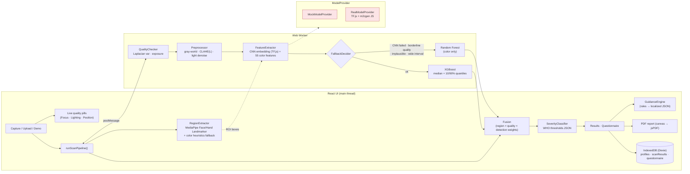

**Why the pipeline is split across threads:**

- **Worker**: quality checks, preprocessing, feature extraction and prediction run in a Web Worker, so the UI stays smooth.
- **Main thread**: MediaPipe runs here because its WASM loader does not support module workers. It is fast (~50 ms per image).
- **OpenCV.js**: loaded from a local copy, never a CDN. If it fails to load (very old WebViews), a pure-TypeScript backend (`JsOps`) with the same interface takes over. The unit tests also use it.

### Folder structure

```
src/
  components/      ui/ (Button, Card, HbGauge, SeverityChip, StatusPill, …), layout/, illustrations/
  pages/           one file per screen (Splash … Settings, Demo)
  features/        camera/, voice/, scan/ (pipeline orchestration, capture flow, save), report/, demo/, sync/
  ml/              types, severityClassifier, fallbackDecider, fusion, regionExtractor, regionAnalyzer,
                   modelProvider, mockModelProvider, realModelProvider, models/ (← trained models go here)
  imageProcessing/ qualityChecker, preprocessor, colorFeatures, colorSpace, jsOps, opencvOps, roiHeuristics
  guidance/        guidanceEngine (rules only — text lives in i18n JSON)
  store/           zustand: settings (persisted), scan session (in-memory)
  db/              Dexie schema + repositories
  i18n/            en / te / hi — common.json (UI) + guidance.json (health content)
  workers/         pipeline.worker.ts + typed client
  config/          appConfig.ts, pipeline.json (shared with training), severityThresholds.json, guide boxes
  utils/
public/
  vendor/opencv/   OpenCV.js (copied on npm install)
  mediapipe/       WASM + hand/face landmarker .task models
  models/          TF.js CNN (after training) — see public/models/README.md
  demo/            synthetic demo images
android/           Capacitor Android project (com.hemoscan.app)
training/          Python training pipeline — see training/README.md
scripts/           asset setup, icon / demo generation, calibration, parity fixtures
```

### Key configuration

| File                                 | Contents                                                                                                       |
| ------------------------------------ | -------------------------------------------------------------------------------------------------------------- |
| `src/config/pipeline.json`           | Preprocessing, feature, quality-gate, fallback and fusion constants. **Shared with the Python training code.** |
| `src/config/severityThresholds.json` | WHO anemia thresholds per age / sex / pregnancy group (editable).                                              |
| `src/config/appConfig.ts` + `.env`   | `VITE_USE_MOCK_MODELS` (default `true`), `VITE_SYNC_API_BASE_URL` (empty = no sync).                           |

---

## Installing trained models

1. Train with the Python pipeline in [`training/`](training/README.md).
2. Run `python training/export.py`. It writes:
   - `public/models/cnn/model.json` + weight shards, and `public/models/model-info.json`
   - `src/ml/models/xgboostModel.ts` and `src/ml/models/randomForestModel.ts`, both verified in Node against the Python models
3. Rebuild. Then set `VITE_USE_MOCK_MODELS=false` in `.env.local`, or choose **Settings → Model source → Trained**.

TF.js is only bundled once real tree models are present. The placeholders make the bundler drop it,
so the demo build stays small. If the CNN files are missing, every region uses the Random Forest
fallback.

---

## Deploying the web app (HTTPS is required for the camera)

Browsers only allow camera access on **HTTPS** (or `localhost`). Without HTTPS the capture screen
explains this and offers **Upload Image**. The app uses hash routing (`/#/home`), so no rewrite rules
are needed.

**Vercel:** `npm i -g vercel && vercel --prod` (settings in `vercel.json`), or import the repo in the
Vercel dashboard.

**Netlify:** `npm i -g netlify-cli && netlify deploy --prod --dir=dist` after `npm run build`
(settings in `netlify.toml`), or connect the repo.

After the first visit the service worker caches the app, fonts, OpenCV.js, the MediaPipe models and
the demo images (~45 MB), so it works fully offline and can be installed from the browser menu
(**Add to Home screen**).

---

## Android APK (Capacitor)

The APK bundles the whole `dist/` folder (models, WASM, fonts), so it works offline from the first
launch. App id: `com.hemoscan.app`. Permissions: `CAMERA` and gallery read. `INTERNET` is used only
by the optional, opt-in sync.

### Debug APK

```bash
export JAVA_HOME=/path/to/jdk-17        # Capacitor 6 / AGP 8.2 need JDK 17 (not 21+)
echo "sdk.dir=$HOME/Library/Android/sdk" > android/local.properties   # or your SDK path
npm run android:build
# → android/app/build/outputs/apk/debug/app-debug.apk
adb install -r android/app/build/outputs/apk/debug/app-debug.apk
```

### Signed release APK

1. Create a keystore once and keep it safe; you need the same key for every update:
   ```bash
   keytool -genkeypair -v -keystore hemoscan-release.keystore -alias hemoscan \
           -keyalg RSA -keysize 2048 -validity 10000
   ```
2. Add `android/keystore.properties` (it is git-ignored, so never commit it):
   ```properties
   storeFile=../hemoscan-release.keystore
   storePassword=********
   keyAlias=hemoscan
   keyPassword=********
   ```
3. In `android/app/build.gradle`, load it and add a signing config:
   ```groovy
   def ksFile = rootProject.file("keystore.properties")
   def ks = new Properties(); if (ksFile.exists()) ks.load(new FileInputStream(ksFile))
   android {
     signingConfigs { release { storeFile file(ks['storeFile']); storePassword ks['storePassword']; keyAlias ks['keyAlias']; keyPassword ks['keyPassword'] } }
     buildTypes { release { signingConfig signingConfigs.release; minifyEnabled false } }
   }
   ```
4. `npm run android:release` → `android/app/build/outputs/apk/release/app-release.apk`
   (or `./gradlew bundleRelease` for a Play Store `.aab`).

Alternatively, run `npm run android:open` and use **Build → Generate Signed Bundle / APK** in Android Studio.

---

## Privacy

- Results are stored **only on the device** (IndexedDB), and images are **never stored**.
- **Contribute anonymous data** (off by default) keeps only the small ROI crops and color features, with no name or age.
- **Sync** (off by default) needs both a configured endpoint and explicit consent. It uploads only the contributed data and checks for model updates. The API in `src/features/sync/syncService.ts` is a stub, and no server is hardcoded.
- **Settings → Delete all data** wipes everything on the device.

---

## Testing

- `npm test` runs 83 unit tests:
  - `QualityChecker`, `FallbackDecider` and `SeverityClassifier` (every WHO band edge)
  - `GuidanceEngine`, including localized content for every rule in all three languages
  - `fusion`, and translation-key parity across en / te / hi
- `cd training && python -m pytest tests/` checks that the Python training code reproduces the app's color features, ROI crops and fallback detections exactly.
- `npm run demo:calibrate` runs the full JS pipeline on the demo images and prints the result for each set.

The whole flow was also driven in Chrome with Playwright, at desktop and 390 px phone widths, in all three languages and in light and dark themes. A demo scan takes about 1.3 s from click to result.

---

## Screenshots

| Home                                   | Results                                   | Guidance                                   | History                                   |
| -------------------------------------- | ----------------------------------------- | ------------------------------------------ | ----------------------------------------- |
| 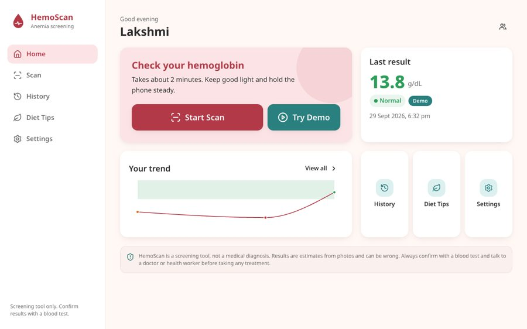 | 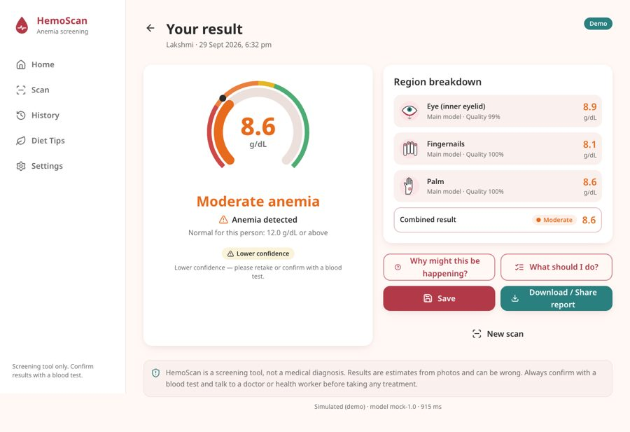 | 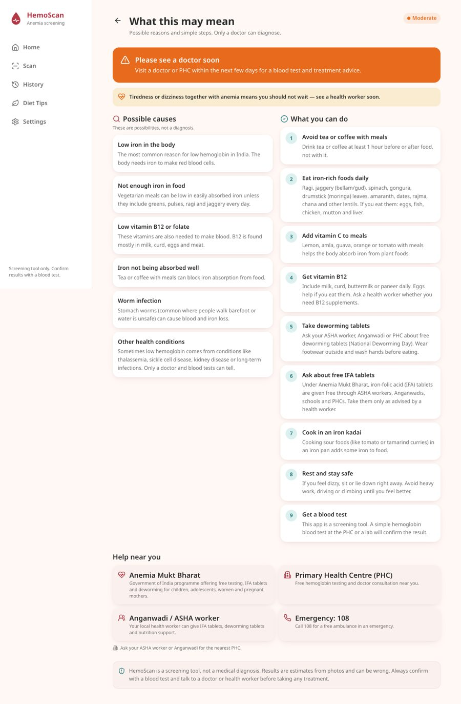 | 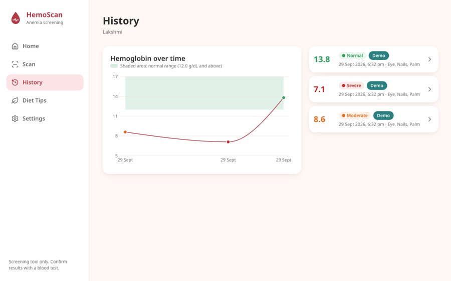 |

| Onboarding                                  | Profile                                  | Demo                                  | Processing                                  | Result                                   | Severe                                          |
| ------------------------------------------- | ---------------------------------------- | ------------------------------------- | ------------------------------------------- | ---------------------------------------- | ----------------------------------------------- |
| 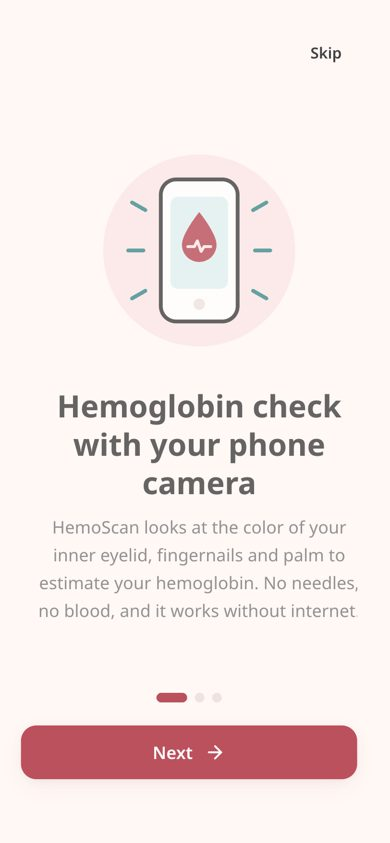 | 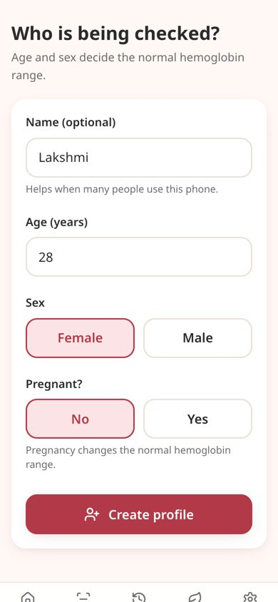 | 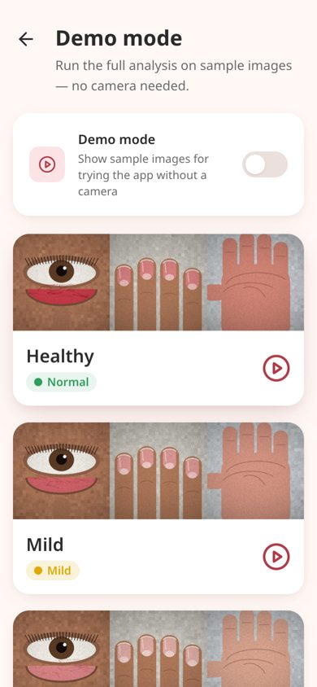 | 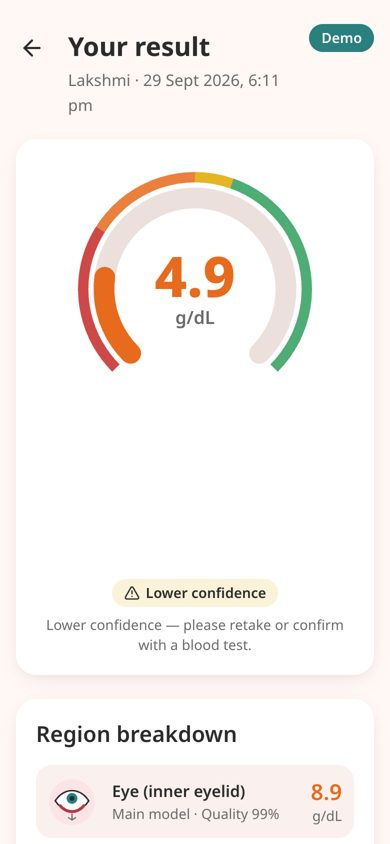 | 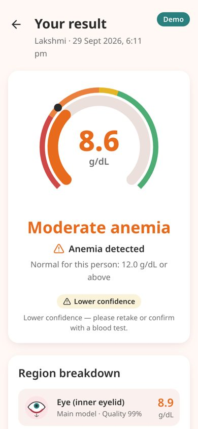 | 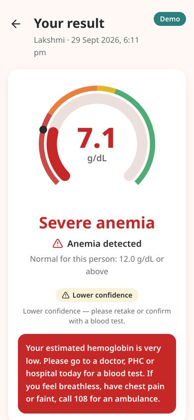 |

| Questionnaire                                  | History                                  | తెలుగు · dark                                     | తెలుగు · regions                                     | हिंदी · result                                |
| ---------------------------------------------- | ---------------------------------------- | ------------------------------------------------- | ---------------------------------------------------- | --------------------------------------------- |
| 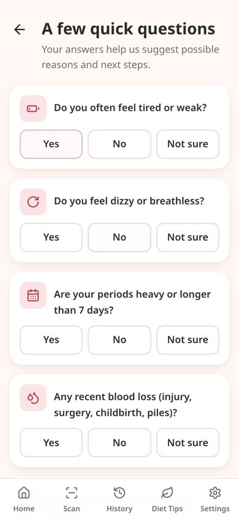 | 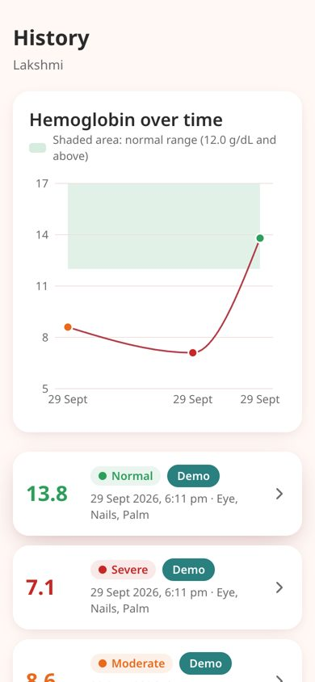 | 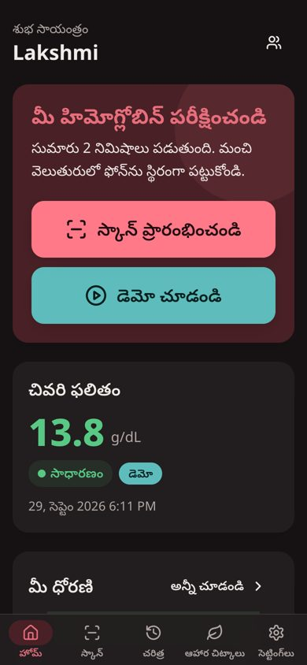 | 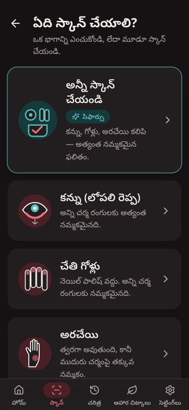 | 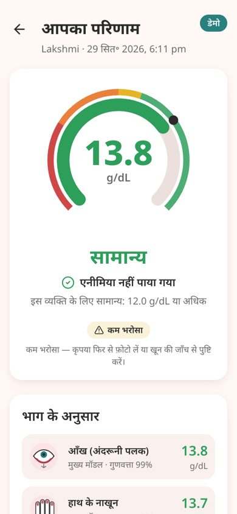 |

---

## Known limitations

- **Models:** the simulated model is not validated. Real accuracy depends entirely on the training
  data, which should be balanced across skin tones and devices. `training/evaluate.py` reports
  performance per Fitzpatrick group.
- **Translations:** the Telugu and Hindi text was written for this project and should be reviewed
  by native-speaking health workers before field use.
- **Voice guidance** uses the device's text-to-speech. Many phones have no Telugu voice; the app
  then keeps on-screen instructions and says so.
- **Torch:** control works only where the browser or WebView exposes it (most Android Chrome
  versions; not iOS Safari).
- **Age:** HemoScan is not intended for infants under 6 months, and the profile screen warns about this.
